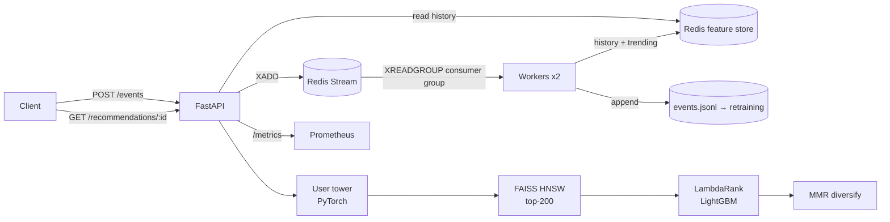

# Real-Time Two-Stage Recommendation Engine

A production-style recommender in the shape used by YouTube, Pinterest and Instacart:
a **PyTorch two-tower model** retrieves 200 candidates from a **FAISS HNSW** index, a
**LightGBM LambdaRank** model re-ranks them, and optional **MMR** diversifies the final list.
It is served by **FastAPI**, and a **Redis Streams** event pipeline updates user features as
events arrive, so a user's very next request reflects what they just watched.

Trained and evaluated on MovieLens (100,836 ratings, 610 users, 9,724 movies) with a strict
per-user temporal split.



## Results (held-out test window, 610 users)

| Model | Recall@10 | NDCG@10 | Recall@50 | NDCG@50 |
|---|---|---|---|---|
| Popularity baseline | 0.0356 | 0.0478 | 0.1211 | 0.0713 |
| Two-tower retrieval | 0.0836 | 0.0839 | 0.2376 | 0.1314 |
| **Two-tower + LambdaRank** | **0.0887** | **0.0965** | **0.2591** | **0.1456** |

* Full pipeline vs. popularity: **2.5x Recall@10, 2.0x NDCG@10, 2.1x Recall@50**
* Re-ranker over retrieval alone: **+15% NDCG@10**, +9% Recall@50
* HNSW approximate search keeps **96.2% recall** of exact search @200
* Inference latency (in-process, Apple M4): **p50 0.89 ms, p99 1.15 ms**
  (user encode 0.06 ms, ANN 0.14 ms, feature build + rerank 0.66 ms)
* HTTP (8 uvicorn workers, 32 concurrent clients, ApacheBench, same laptop): **~1,450 req/s, p50 15 ms**
* Full offline pipeline (train, index, rank, evaluate, version): **~18 s on CPU**

Every number above is written by the pipeline to `artifacts/<version>/manifest.json`.

## How it works

**Leakage-free splits.** Each user's interactions are sorted by time: the oldest 80% train the
tower, the next 10% train the re-ranker, the newest 10% are the test set. Every training example
uses only interactions *strictly before* its target (`tests/test_offline.py` enforces both).

**Stage 1: two-tower retrieval (`recsys/two_tower.py`).**
* Item tower: id embedding + genre multi-hot + release year → MLP → L2-normalized 64-d vector.
* User tower: user id embedding + mean-pooled history + mean of the last 5 items + genre profile → MLP.
  The history embeddings are shared with the item tower, so a user with *no* id (cold start)
  is still encoded from what they watched in this session.
* Loss: in-batch sampled softmax with **logQ correction** (removes the popularity bias of
  in-batch negatives) and **duplicate-target masking** (an item is never its own negative).
* **User-id dropout (15%)** trains the anonymous-user path explicitly.
* Best epoch picked by validation Recall@100.

**ANN index (`recsys/index.py`).** FAISS `IndexHNSWFlat` (M=32, efSearch=128) over inner product;
already-watched items are over-fetched and filtered.

**Stage 2: LambdaRank (`recsys/ranker.py`, `recsys/features.py`).** 11 features per (user,
candidate): two-tower score and rank, popularity, Bayesian-shrunk average rating,
**time-windowed popularity (30/180 days before the request)**, item age at request time,
genre affinity, user activity, and max/mean embedding similarity to the last 5 items.
Early stopping runs on 20% of queries held out. The same `build_features` function runs in
training and serving, so there is no training/serving skew.

**Diversity (`recsys/service.py`).** Maximal Marginal Relevance over item embeddings, tunable
per request via `?diversity=0..1`.

**Real-time features (`recsys/feature_store.py`, `worker/stream_consumer.py`).**
`POST /events` does an `XADD` and returns `202` right away. A consumer group of workers applies
events (append to a capped user history, `ZINCRBY` trending) and acks only afterwards. Messages
left unacked after a crash are re-delivered. Events are also logged to `events.jsonl` for the
next training run. With no `REDIS_URL`, an in-memory store applies events inline.

**Ops.** Versioned artifacts (`artifacts/vYYYYMMDD-HHMMSS/` + `LATEST` pointer),
zero-downtime **hot model swap** via `POST /admin/reload`, Prometheus histograms for
end-to-end and per-stage latency aggregated across uvicorn workers, Docker Compose stack, and
GitHub Actions CI.

## API

| Method | Path | Purpose |
|---|---|---|
| GET | `/recommendations/{user_id}?k=10&diversity=0.3&explain=true` | Personalized recs; `explain` adds "because you watched X" |
| POST | `/recommendations` | Anonymous session: `{"history": [1, 2355, 3114], "k": 10}` |
| POST | `/events` | Ingest `{"user_id", "movie_id", "event_type"}` (async, 202) |
| GET | `/items/{movie_id}/similar` | Item-to-item similarity from the item tower |
| GET | `/trending` | Real-time trending from the event stream |
| GET | `/model` | Version, offline metrics, feature importance |
| POST | `/admin/reload` | Hot-swap to the `LATEST` artifact |
| GET | `/metrics`, `/health` | Prometheus metrics, liveness |

Example (new user, after a single "watched Star Wars" event):

```bash
curl -XPOST localhost:8000/events -H 'content-type: application/json' -d '{"user_id": 9999, "movie_id": 260}'
curl 'localhost:8000/recommendations/9999?k=3'
# -> The Empire Strikes Back, Return of the Jedi, Raiders of the Lost Ark
```

## Run it

```bash
# Local
python3.13 -m venv .venv && .venv/bin/pip install -r requirements-dev.txt
make data train test     # download MovieLens, train (~18 s), run 16 tests
make serve               # API on :8000 (in-memory store)
make bench               # latency benchmark

# Full stack: Redis + trainer + API + 2 workers + Prometheus
docker compose up --build        # API_PORT / PROMETHEUS_PORT override the host ports
```

## Layout

```
recsys/     data.py (splits), two_tower.py, index.py, features.py, ranker.py,
            pipeline.py (offline train/eval/versioning), service.py (online inference),
            feature_store.py (Redis / in-memory), metrics.py
api/        FastAPI app + pydantic schemas
worker/     Redis Streams consumer-group worker
scripts/    train.py, benchmark.py, download_data.sh
tests/      offline (leakage, loss, ANN, MMR, metrics) + serving (API, cold start, worker)
```
